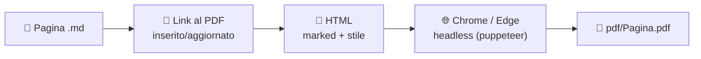

# wiki-pdf

Generatore di **PDF per le wiki GitHub**. Converte ogni pagina Markdown della wiki in un PDF A4 con intestazione, piè di pagina, schemi Mermaid e immagini, e inserisce nella pagina il link **📄 Scarica PDF**, così chi legge la wiki può scaricare e stampare ogni pagina.

Il codice è uno solo per tutte le wiki: ogni wiki fornisce soltanto il proprio file di configurazione `wiki.config.json`.

> **In breve** — Nella wiki crei `tools/pdf/package.json` e `tools/pdf/wiki.config.json`, lanci `npm install` e `npm run build`: in `pdf/` trovi un PDF per ogni pagina. Vedi [Installazione in una wiki](#installazione-in-una-wiki).

---

## Indice

- [Come funziona](#come-funziona)
- [Requisiti](#requisiti)
- [Installazione in una wiki](#installazione-in-una-wiki)
- [Uso](#uso)
- [Configurazione: wiki.config.json](#configurazione-wikiconfigjson)
- [Marcatori nelle pagine](#marcatori-nelle-pagine)
- [Specifica del rendering](#specifica-del-rendering)
- [Comando check](#comando-check)
- [Riferimento del comando wiki-pdf](#riferimento-del-comando-wiki-pdf)
- [Uso da codice (API)](#uso-da-codice-api)
- [Uso in GitHub Actions](#uso-in-github-actions)
- [Versioni e aggiornamento](#versioni-e-aggiornamento)
- [Sviluppo del pacchetto](#sviluppo-del-pacchetto)
- [Problemi comuni](#problemi-comuni)
- [Licenza](#licenza)

---

## Come funziona



1. Legge `wiki.config.json` e individua la cartella della wiki.
2. Per ogni pagina `.md` da generare inserisce o aggiorna il link al PDF sotto il titolo (la pagina viene **modificata su disco**).
3. Converte il Markdown in HTML con `marked` (GitHub Flavored Markdown, ancore compatibili con GitHub).
4. Apre l'HTML in Chrome o Edge senza finestra, attende il disegno degli schemi Mermaid e stampa il PDF in `<outDir>/<Pagina>.pdf`.
5. Stampa a console il numero di pagine di ogni PDF e gli eventuali avvisi.

Il pacchetto non contiene dati delle wiki: le wiki lo installano da questo repository con `npm install`.

---

## Requisiti

| Requisito | Note |
|---|---|
| **Node.js 18 o superiore** | Usa i moduli ES e `fetch` nativo. |
| **Chrome o Edge** installato | Cercato nei percorsi standard di Windows, Linux e macOS; altrimenti impostare `CHROME_PATH`. Non viene scaricato nessun browser (si usa `puppeteer-core`). |
| **Git** | Necessario per `npm install` da GitHub e per il comando `check`. Il repository è pubblico: non servono chiavi né token. |
| **gh** (facoltativo) | Solo per le pagine che contengono immagini allegate `github.com/user-attachments` (vedi [Immagini](#immagini)). |

Dopo `npm install` non serve la connessione a internet: Mermaid è incluso nel pacchetto.

---

## Installazione in una wiki

### Passo 1: struttura

Nella wiki si crea la cartella `tools/pdf` con due soli file:

```text
<wiki>/
├── Home.md, Pagina.md, ...
├── images/
├── pdf/                    ← PDF generati (committati)
└── tools/pdf/
    ├── package.json        ← dipendenza da wiki-pdf
    └── wiki.config.json    ← configurazione della wiki
```

Esempi completi in [`examples/tools/pdf`](examples/tools/pdf).

### Passo 2: package.json

```json
{
  "name": "wiki-pdf-local",
  "private": true,
  "type": "module",
  "scripts": {
    "build": "wiki-pdf build",
    "check": "wiki-pdf check"
  },
  "dependencies": {
    "wiki-pdf": "github:AlessandroNava/wiki-pdf#v1.0.0"
  }
}
```

La parte dopo `#` è il **tag della versione** da usare: ogni wiki sceglie quando aggiornarsi (vedi [Versioni](#versioni-e-aggiornamento)).

### Passo 3: wiki.config.json

```json
{
  "$schema": "./node_modules/wiki-pdf/wiki.config.schema.json",
  "wikiUrl": "https://github.com/<utente>/<repo>/wiki",
  "wikiRoot": "../..",
  "label": "Nome della wiki"
}
```

`wikiRoot: "../.."` indica che la wiki è due cartelle sopra `tools/pdf`. Tutte le chiavi sono descritte in [Configurazione](#configurazione-wikiconfigjson).

### Passo 4: .gitignore della wiki

```gitignore
node_modules/
pdf/.*.html
```

### Passo 5: installazione e prima generazione

```bash
cd tools/pdf
npm install
npm run build
```

Committare `tools/pdf/package.json`, `tools/pdf/package-lock.json`, `tools/pdf/wiki.config.json`, le pagine modificate (link al PDF aggiunto) e la cartella `pdf/`.

---

## Uso

Da `tools/pdf` della wiki:

```bash
npm run build                          # tutti i PDF
npm run build -- Installazione Home    # solo alcune pagine (nome del file senza .md)
npm run check                          # elenca i PDF da rigenerare
```

Esempio di output:

```text
✔ pdf/Installazione.pdf (4 pag.)
✔ pdf/Guida-rapida.pdf (2 pag.)
  ⚠ guida rapida su più di un foglio
```

> I PDF di Chrome non sono identici byte per byte tra due generazioni: ogni `build` modifica tutti i PDF generati anche se le pagine non sono cambiate. Per sapere quali PDF servono davvero usare `check`.

---

## Configurazione: wiki.config.json

Il file è validato all'avvio: chiavi sconosciute o valori non validi fermano il comando con un messaggio che indica il problema. Lo schema JSON [`wiki.config.schema.json`](wiki.config.schema.json) permette la validazione e il completamento automatico nell'editor (chiave `$schema`).

| Chiave | Tipo | Default | Obbligatoria | Descrizione |
|---|---|---|:---:|---|
| `wikiUrl` | URL | — | ✅ | Indirizzo della wiki pubblicata, senza `/` finale. I link interni `./Pagina` e `./Pagina#ancora` diventano `<wikiUrl>/Pagina#ancora` nel PDF. |
| `wikiRoot` | percorso | `"."` | | Cartella che contiene le pagine `.md`, **relativa al file di configurazione**. In `tools/pdf` vale `"../.."`. Accetta anche un percorso assoluto. |
| `label` | testo | `"Wiki"` | | Etichetta nell'intestazione e nel piè di pagina di ogni PDF. |
| `accent` | colore `#rrggbb` | `"#e8471c"` | | Colore principale: linea dell'intestazione, titoli, bordi dei riquadri. |
| `accentSoft` | colore `#rrggbb` | `"#fff4ef"` | | Colore tenue per sfondi di riquadri e intestazioni di tabella. |
| `logo` | percorso o `null` | `null` | | Immagine dell'intestazione (png, jpg, svg), **relativa alla cartella della wiki**. Incorporata nel PDF. |
| `linkStyle` | `"markdown"` \| `"html-right"` | `"markdown"` | | Forma del link al PDF nella pagina (vedi sotto). |
| `landscapeDiagramMaxHeight` | misura CSS | `"95mm"` | | Altezza massima degli schemi nelle pagine landscape. Valori più bassi lasciano spazio sotto lo schema nella prima pagina. |
| `exclude` | elenco di nomi | `[]` | | Pagine senza PDF (nome del file senza `.md`). Utile per indici e pagine di manutenzione. |
| `outDir` | percorso | `"pdf"` | | Cartella dei PDF, relativa alla wiki. Determina anche il percorso nel link (`<outDir>/<Pagina>.pdf`). |
| `locale` | codice lingua | `"it-IT"` | | Formato della data nel piè di pagina e attributo `lang` dell'HTML. |

### Stili del link al PDF (`linkStyle`)

| Valore | Testo inserito | Aspetto su GitHub |
|---|---|---|
| `markdown` | `[📄 Scarica PDF](pdf/Pagina.pdf)` | Link su una riga, a sinistra |
| `html-right` | `<p align="right"><a href="pdf/Pagina.pdf">📄 Scarica in PDF</a></p>` | Link allineato a destra |

Il generatore riconosce entrambe le forme: cambiando `linkStyle` i link esistenti vengono convertiti alla generazione successiva.

### Esempi

Manuale utente con intestazione blu e link allineato a destra:

```json
{
  "wikiUrl": "https://github.com/<utente>/<app>/wiki",
  "wikiRoot": "../..",
  "label": "La mia app · Manuale d'uso",
  "accent": "#0969da",
  "accentSoft": "#eef5ff",
  "logo": "images/Logo/logo.png",
  "linkStyle": "html-right",
  "landscapeDiagramMaxHeight": "75mm",
  "exclude": ["Manuals", "PDF-Generation"]
}
```

Documentazione tecnica con i colori predefiniti, senza PDF per gli indici:

```json
{
  "wikiUrl": "https://github.com/<utente>/<progetto>/wiki",
  "wikiRoot": "../..",
  "label": "Documentazione del progetto",
  "linkStyle": "markdown",
  "exclude": ["Home", "Flows"]
}
```

---

## Marcatori nelle pagine

Commenti HTML su una riga a sé, invisibili su GitHub, che cambiano l'impaginazione del PDF. Di solito si mettono nella prima riga, prima del titolo.

| Marcatore | Effetto |
|---|---|
| `<!-- pdf: landscape -->` | A4 **orizzontale**; gli schemi Mermaid occupano tutta la larghezza, con altezza massima `landscapeDiagramMaxHeight`. Pensato per le pagine di flussi. |
| `<!-- pdf: compact -->` | Caratteri e spaziature ridotti, separatori `---` nascosti: per guide rapide da **un foglio**. Se il PDF supera una pagina compare l'avviso `guida rapida su più di un foglio`. |

I due marcatori si possono combinare. Link e marcatori scritti dentro un blocco di codice (```` ``` ````) sono ignorati, così la documentazione può mostrarli come esempio.

---

## Specifica del rendering

### Pagine considerate

- Tutti i file `*.md` nella cartella della wiki (non nelle sottocartelle).
- Esclusi i file che iniziano con `_` (`_Sidebar.md`, `_Footer.md`) e i nomi elencati in `exclude`.
- Con `build -- Pagina1 Pagina2` solo le pagine indicate; un nome inesistente o escluso produce un avviso.

### Link al PDF nella pagina

- Se la pagina contiene già un link al PDF (in una delle due forme) viene aggiornato **nella stessa posizione**.
- Altrimenti viene inserito dopo il titolo `# …` iniziale (anche se preceduto da un commento come `<!-- pdf: landscape -->`), separato da righe vuote; se la pagina non inizia con un titolo, viene inserito in cima.
- Le terminazioni di riga della pagina (LF o CRLF) vengono rispettate.
- Il link viene tolto dal contenuto stampato nel PDF.

### Titolo del PDF

In ordine: primo titolo `# …` o `<h1>` della pagina (senza emoji né formattazione), poi il testo del link alla pagina in `_Sidebar.md`, infine il nome del file con `-` sostituiti da spazi.

### Markdown

- `marked` con GitHub Flavored Markdown (tabelle, liste di attività, testo barrato, link automatici).
- Ancore dei titoli generate come su GitHub (`marked-gfm-heading-id`), quindi i link `#ancora` funzionano anche nel PDF.
- HTML nelle pagine mantenuto (es. `<p align="center">`, ``, `<sub>`).
- Shortcode: `:top:` → ⬆️.
- Link interni `./Pagina` → `<wikiUrl>/Pagina`; i link esterni restano invariati.

### Schemi Mermaid

- I blocchi ```` ```mermaid ```` vengono disegnati con Mermaid 10.9.1 incluso nel pacchetto, tema `neutral`.
- Il generatore attende la fine del disegno (massimo 30 s); gli schemi non disegnati producono l'avviso `schema/i mermaid non disegnato/i`.

### Immagini

- I percorsi relativi (`images/…`) sono risolti rispetto alla cartella della wiki.
- Le immagini allegate dall'editor web di GitHub (`https://github.com/user-attachments/assets/…`) dei repository privati vengono scaricate con `GITHUB_TOKEN` o, se assente, con il token di `gh auth token`, e incorporate nel PDF. Senza token compare un avviso e l'immagine manca.
- Le immagini che non si caricano producono l'avviso `immagine non caricata: …`.

### Impaginazione

| Elemento | Contenuto |
|---|---|
| Formato | A4 verticale (orizzontale con `landscape`), margini 22/16/20/16 mm, sfondi stampati. |
| Intestazione | Logo, `label` e titolo della pagina, con linea nel colore `accent`. |
| Piè di pagina | `label · titolo · data` a sinistra, `Pagina N di M` a destra. |
| Stile | `src/style.css` (carattere Segoe UI, 10,5 pt; titoli, tabelle, riquadri, codice); colori da `accent` e `accentSoft`. Regole di interruzione di pagina per non spezzare tabelle, immagini e schemi. |

### File temporanei

Per ogni pagina viene creato `<outDir>/.<Pagina>.html`, cancellato al termine anche in caso di errore (da escludere comunque con `.gitignore`).

---

## Comando check

`wiki-pdf check` confronta, con Git, ogni pagina con il proprio PDF e segnala:

| Messaggio | Condizione |
|---|---|
| `PDF mancante` | La pagina dovrebbe avere un PDF ma il file non esiste. |
| `pagina modificata e non committata` | La pagina ha modifiche non committate e il PDF no. |
| `pagina modificata dopo il PDF` | L'ultimo commit della pagina è più recente di quello del PDF. |

Termina con il comando `npm run build -- …` da lanciare. Non rileva le modifiche a immagini, stile o configurazione: dopo questi cambiamenti rigenerare tutto.

---

## Riferimento del comando wiki-pdf

```text
wiki-pdf build [--config <file>] [Pagina ...]
wiki-pdf check [--config <file>]
wiki-pdf --help
```

| Opzione | Descrizione |
|---|---|
| `--config <file>`, `-c <file>` | File di configurazione. Default: `./wiki.config.json` nella cartella da cui si lancia il comando. |
| `--help`, `-h` | Mostra l'aiuto. |

| Variabile d'ambiente | Descrizione |
|---|---|
| `CHROME_PATH` | Percorso dell'eseguibile di Chrome o Edge, se non è in un percorso standard. |
| `GITHUB_TOKEN` | Token per scaricare le immagini `user-attachments`; in sua assenza si usa `gh auth token`. |

| Codice di uscita | Significato |
|---|---|
| `0` | Completato (gli avvisi non cambiano il codice). |
| `1` | Errore (configurazione non valida, browser non trovato, pagina non stampabile) oppure, per `check`, PDF da rigenerare. |

---

## Uso da codice (API)

```js
import { loadConfig, build, check } from 'wiki-pdf';

const ctx = loadConfig('tools/pdf/wiki.config.json');   // { config, wiki, out, file }
const results = await build(ctx, ['Home']);              // [{ name, pages, warnings }]
const outdated = check(ctx);                             // [{ name, reason }]
```

Esportati anche `listPages(wiki, config)`, `DEFAULTS`, `LANDSCAPE_MARKER`, `COMPACT_MARKER`.

---

## Uso in GitHub Actions

Il repository è pubblico, quindi un workflow lo installa senza chiavi né token aggiuntivi. Le Actions non possono girare nel repository della wiki: si usa l'evento `gollum` (modifica di una pagina) del repository principale e si fa il checkout della wiki.

```yaml
on:
  gollum:
  workflow_dispatch:

permissions:
  contents: write

jobs:
  build-pdf:
    runs-on: ubuntu-latest
    steps:
      - uses: actions/checkout@v4
        with:
          repository: ${{ github.repository }}.wiki
          path: wiki
```

Poi, nello stesso job:

```yaml
- uses: actions/setup-node@v4
  with:
    node-version: 20
- run: npm ci
  working-directory: wiki/tools/pdf
- run: npm run build
  working-directory: wiki/tools/pdf
```

Sui runner `ubuntu-latest` Chrome è già installato in `/usr/bin/google-chrome`. Per le emoji nei PDF installare `fonts-noto-color-emoji`. Infine fare commit e push della cartella `pdf/` (e delle pagine a cui è stato aggiunto il link) nella wiki.

---

## Versioni e aggiornamento

- Le versioni seguono [Semantic Versioning](https://semver.org/lang/it/) e si pubblicano come **tag Git** `vX.Y.Z` su questo repository.
  - **patch** (`1.0.1`): correzioni che non cambiano l'aspetto dei PDF in modo voluto;
  - **minor** (`1.1.0`): nuove chiavi di configurazione o nuovi marcatori, retrocompatibili;
  - **major** (`2.0.0`): cambi che richiedono di modificare `wiki.config.json` o le pagine.
- Per aggiornare una wiki: cambiare il tag in `tools/pdf/package.json`, poi `npm install`, `npm run build` e controllare i PDF prima di committare.
- Le novità di ogni versione sono in [CHANGELOG.md](CHANGELOG.md).

---

## Sviluppo del pacchetto

```text
wiki-pdf/
├── bin/wiki-pdf.mjs           comando da terminale (argomenti, output, codici di uscita)
├── src/config.mjs             lettura, default e validazione di wiki.config.json
├── src/build.mjs              generazione dei PDF
├── src/check.mjs              confronto pagine/PDF con Git
├── src/index.mjs              API esportata
├── src/style.css              stile di stampa
├── wiki.config.schema.json    schema JSON della configurazione
└── examples/tools/pdf/        file da copiare in una nuova wiki
```

Per provare una modifica su una wiki **senza pubblicare** una versione:

```bash
cd <wiki>/tools/pdf
npm install --no-save ../../../wiki-pdf             # usa la copia locale (percorso della tua copia)
npm run build
npm install                                          # torna alla versione del package.json
```

Prima di pubblicare un tag:

1. generare i PDF di tutte le wiki e confrontare numero di pagine e aspetto con la versione precedente;
2. aggiornare `CHANGELOG.md` e la versione in `package.json`;
3. `git tag vX.Y.Z && git push --tags`.

---

## Problemi comuni

| Problema | Causa | Soluzione |
|---|---|---|
| `npm install` fallisce con `Repository not found` o errori di rete | Tag inesistente o GitHub non raggiungibile | Controllare il tag dopo `#` in `package.json` (deve esistere tra i tag del repository) e la connessione. |
| `Chrome/Edge non trovato` | Browser in un percorso non standard | Impostare `CHROME_PATH`. |
| `Configurazione non trovata` | Comando lanciato fuori da `tools/pdf` | Lanciarlo da `tools/pdf` o usare `--config`. |
| `Cartella della wiki non trovata` | `wikiRoot` errato | È relativo al file di configurazione: in `tools/pdf` vale `"../.."`. |
| `chiave sconosciuta "…"` | Errore di battitura o chiave di una versione più recente | Correggere il nome o aggiornare il tag di `wiki-pdf`. |
| `guida rapida su più di un foglio` | Pagina `compact` troppo lunga | Accorciare il testo o ridurre le immagini. |
| `schema/i mermaid non disegnato/i` | Errore di sintassi nello schema | Provare lo schema su [mermaid.live](https://mermaid.live). |
| Emoji come quadratini (Linux) | Font emoji mancante | Installare `fonts-noto-color-emoji`. |

---

## Licenza

[MIT](LICENSE) © Alessandro Nava. Puoi usare, modificare e ridistribuire il pacchetto liberamente, anche in progetti commerciali.
